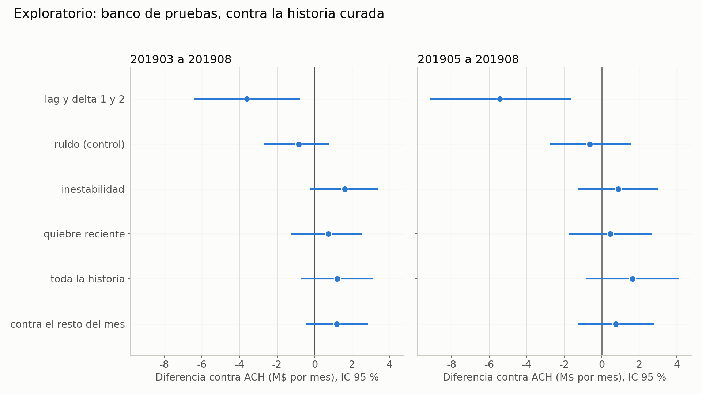
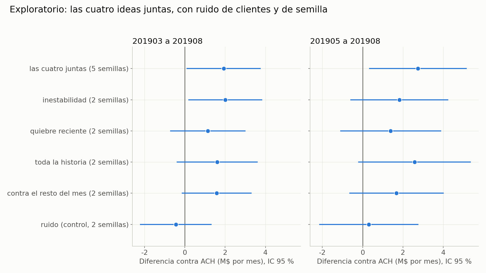
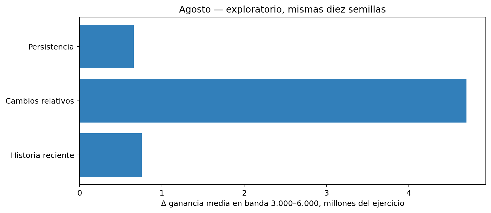

# Experimento feature_historico dónde estamos

**Versión de trabajo para tutoría del grupo completo.** Conserva el orden y el enfoque del PDF nuevo de Ezequiel, incorporando la evidencia publicada hasta el commit 6cf189c y nuestras corridas de Google Cloud. El PDF original se conserva sin editar.

**Corte de nuestras métricas:** 2026-11-06T23:01:55.994865+00:00 (UTC). Los resultados parciales se identifican como tales. Integrantes: Tomás Henseler, Clara M. Rodríguez y Ezequiel Abregú. Tutor: Alejandro Bolaños.

La historia básica aporta valor, pero mejorarla es más difícil. El experimento original no superó la regla propia de ganancia; las exploraciones posteriores dejaron señales pequeñas. El nuevo banco por clientes encuentra una señal intermedia para cuatro bloques juntos. En nuestras pruebas de AUC, historia reciente y cambios relativos no mejoraron; persistencia dio una mejora pequeña que no fue uniforme entre semillas. Rankings sigue pendiente al corte.

## El problema y el baseline

El objetivo del ejercicio es identificar clientes por abandonar el banco. En la métrica económica usada por el grupo, contactar a un BAJA+2 suma 1.072.500 y contactar a otro cliente resta 27.500. Un acierto compensa 39 errores; el punto de equilibrio del estímulo corresponde a una probabilidad de BAJA+2 de 2,5 %. Estos valores son los del ejercicio, no una estimación de beneficio real del banco.

El baseline de la cátedra ya contiene historia: 152 variables actuales, lag1 y lag2, y delta1 y delta2, total 760 columnas. Lag busca el mes calendario exacto del mismo cliente; delta es actual menos lag. No se incluyen ID, foto_mes ni clase como predictores en los notebooks revisados.

| Control | Entrenamiento | Ajuste y función |
|---|---|---|
| A | Mayo–junio | Control del experimento principal; ventana adaptada para tener hasta cuatro meses anteriores |
| A-consigna / AC | Marzo–junio | Conserva meses de la consigna, con parámetros elegidos sobre A; AC añade correcciones de dos roturas Master en octubre |
| ACO | Marzo–junio | Ajuste propio del 07, 339 árboles; control de nuestra serie de AUC |
| ACH | Marzo–junio o banco por clientes, según el experimento | AC más 120 features de historia curada sobre 30 variables; no es el baseline de la cátedra |

La evaluación original usa agosto para AUC, early stopping y N; octubre para el contraste principal y septiembre como control adicional. Entrenamiento positivo: BAJA+1 o BAJA+2; AUC de evaluación positiva: BAJA+2. La ganancia se calcula exclusivamente con BAJA+2. Los distintos ajustes, ventanas y métricas no se mezclan en un único ranking de ganadores.

Diferencias documentadas frente a la referencia de la cátedra: saneamiento retrospectivo de roturas; septiembre como mes adicional; y, para A, ventana mayo–junio. La búsqueda propia de marzo–junio del 07 elevó la AUC de selección, pero no la ganancia posterior. Consultar al tutor qué adaptaciones acepta.

Hipótesis original: al menos una variante con tres o cuatro meses mejora la ganancia de A en octubre bajo una regla propia predefinida. Hipótesis secundaria: la ganancia crece al agregar meses. La principal no se confirmó bajo esa regla; la secundaria tuvo una señal descriptiva más clara de dos a tres meses que de tres a cuatro.

La regla no fue exigida por la consigna: pide p de Wilcoxon ajustado por Holm menor que 0,05 en seis contrastes, diferencia media positiva en octubre y no negativa en septiembre. Todas las variantes cumplieron las condiciones de dirección, pero ninguna la de p ajustado. No pasar no demuestra efecto nulo.

## Qué se probó y qué dio

| Paso | Pregunta | Resultado disponible |
|---|---|---|
| Preparación y mínimo 01–02 | ¿Datos, clase y pipeline están listos? | Controles de filas/clases; ensayo A–LT4 con cinco semillas en agosto |
| 1 Prueba principal 03–04 | ¿Tres o cuatro meses mejoran sobre dos? | Ventajas medias de ganancia, ninguna pasa la regla de seis contrastes |
| 2 Exploraciones 05–11 | ¿Otras representaciones o puntajes suman? | Señales pequeñas y dependientes del mes; resultados posteriores a abrir test |
| 3 Cambio de pregunta 12 | ¿Cuánto vale la historia y entrenar más cerca? | Unos 20 M/mes de banda al recuperar historia básica; mejoras variables al acercar la ventana |
| 4 Banco por clientes 13 | ¿Podemos medir con menor ruido? | Cuatro bloques solos: +0,74 a +1,60 M/mes frente a ACH en el banco |
| 5 Combinación 14 | ¿Los cuatro bloques juntos se complementan? | +1,9263 M/mes; señal intermedia; no supera claramente la mejor idea sola |
| 6 Nuestra serie de AUC | ¿Otras transformaciones superan ACO en agosto? | Dos negativos, persistencia pequeña y rankings en curso al corte |

### Preparación y prueba mínima

El original tiene 4.707.495 filas y 154 columnas; el corte 2019 tiene 1.563.565 filas y cero claves duplicadas. La clase se construye con calendario hasta diciembre de 2019. Se identificaron 23 casos de variable/mes roto y luego dos correcciones Master adicionales. La detección de calidad usa información retrospectiva y se declara como limitación. El ensayo mínimo 02 compara A con LT4 en agosto y sirve para probar el pipeline; no es un test independiente.

### Paso 1 La regla y los dos controles

| Variante contra A | Δ septiembre M | Δ octubre M | p sin ajustar | p Holm | Pasa regla |
|---|---:|---:|---:|---:|---|
| L3 | +4.6750 | +3.4650 | 0.1211 | 0.2422 | No |
| L4 | +6.0225 | +5.0325 | 0.0293 | 0.1465 | No |
| T3 | +5.0600 | +3.6300 | 0.0410 | 0.1484 | No |
| T4 | +4.1525 | +3.6025 | 0.1562 | 0.2422 | No |
| LT3 | +6.1875 | +5.4175 | 0.0117 | 0.0703 | No |
| LT4 | +5.1150 | +5.2250 | 0.0371 | 0.1484 | No |

L suma lags/deltas, T suma pendiente, promedio, mínimo y máximo, y LT combina ambas. Las ventanas extendidas se adaptan al tipo de variable. Las diez configuraciones se evaluaron con diez semillas cada una. LT3 es la más cercana, pero p Holm 0,0703 no cumple el umbral. Agregar semillas hasta que el p baje no es una regla válida de parada.

### Paso 2 Exploraciones de 05 a 11

| Notebook | Qué agrega | Lectura |
|---|---|---|
| 05 | Ensambles y segundas diferencias | Ensambles con señales puntuales; segundas diferencias sin mejora consistente |
| 06 | Ratio3, rachas de ceros y combinación | Ratio3 dejó señal de ganancia; rachas solas generalmente desfavorables |
| 07 | Parámetros propios para marzo–junio | Mejor AUC de selección sin mejora de ganancia posterior |
| 08 | Historia curada, lags/tendencias sin quitar meses y mezclas | Señales más favorables en octubre que en septiembre |
| 09 | Eventos, ratios entre tarjetas, puntaje y hojas RF | Ahora sí hay resultados publicados en 6cf189c; el informe anterior con fuente 3b44f21 quedó desactualizado |
| 10 | Puntaje actual separado del pasado y otras particiones por cliente | Permite distinguir aporte del nivel actual y de la trayectoria de riesgo |
| 11 | Puntaje pasado con particiones B y C | Explora sensibilidad a cómo se divide a los clientes |

La historia curada (ACH) usa ratio3 (actual frente a promedio de tres fotos), z4 (apartamiento frente al pasado), relmax4 (actual frente a máximo previo) y mes_ratio3 (posición del ratio dentro del mes). El puntaje pasado usa predicciones de un modelo construido para no entrenar con el cliente que recibe el puntaje.

Para no seleccionar solo ejemplos favorables, se conservan todos los contrastes por semilla de 09–11. Diferencias de ganancia contra el control indicado; banda: promedio entre 3.000 y 6.000 envíos.

#### Contrastes del 09

| Variante | Control | Δ ganancia septiembre M | Δ ganancia octubre M | Δ banda octubre M |
|---|---|---:|---:|---:|
| ACH | AC | +1.5675 | +5.1975 | +5.4438 |
| ACE | AC | -0.4400 | +5.6100 | +5.3351 |
| ACR | AC | -1.5950 | +5.1150 | +5.9371 |
| ACP | AC | +4.7850 | +4.1250 | +5.9410 |
| ACF | AC | +1.5400 | +5.8300 | +5.3191 |
| ACK | AC | +0.7425 | +5.2525 | +4.0581 |
| ACX | AC | +1.0725 | +6.1325 | +7.2899 |
| ACE | ACH | -2.0075 | +0.4125 | -0.1087 |
| ACR | ACH | -3.1625 | -0.0825 | +0.4934 |
| ACP | ACH | +3.2175 | -1.0725 | +0.4972 |
| ACF | ACH | -0.0275 | +0.6325 | -0.1247 |
| ACK | ACH | -0.8250 | +0.0550 | -1.3857 |
| ACX | ACH | -0.4950 | +0.9350 | +1.8461 |

#### Contrastes del 10

| Variante | Control | Δ ganancia septiembre M | Δ ganancia octubre M | Δ banda octubre M |
|---|---|---:|---:|---:|
| ACH | AC | +1.5675 | +5.1975 | +5.4438 |
| ACP | AC | +4.7850 | +4.1250 | +5.9410 |
| ACP0 | AC | +5.3625 | +3.0525 | +4.3214 |
| ACPH | AC | +4.7300 | +6.7100 | +5.3088 |
| ACP_B | AC | +5.3350 | +4.6750 | +4.4189 |
| ACP_C | AC | +5.8300 | +5.7200 | +4.5517 |
| ACP | ACH | +3.2175 | -1.0725 | +0.4972 |
| ACP0 | ACH | +3.7950 | -2.1450 | -1.1224 |
| ACPH | ACH | +3.1625 | +1.5125 | -0.1349 |
| ACP_B | ACH | +3.7675 | -0.5225 | -1.0249 |
| ACP_C | ACH | +4.2625 | +0.5225 | -0.8921 |
| ACPH | ACP0 | -0.6325 | +3.6575 | +0.9874 |

#### Contrastes del 11

| Variante | Control | Δ ganancia septiembre M | Δ ganancia octubre M | Δ banda octubre M |
|---|---|---:|---:|---:|
| ACH | AC | +1.5675 | +5.1975 | +5.4438 |
| ACPH | AC | +4.7300 | +6.7100 | +5.3088 |
| ACPH_B | AC | +4.6200 | +7.5900 | +6.4594 |
| ACPH_C | AC | +5.9125 | +6.2425 | +5.9345 |
| ACPH | ACH | +3.1625 | +1.5125 | -0.1349 |
| ACPH_B | ACH | +3.0525 | +2.3925 | +1.0157 |
| ACPH_C | ACH | +4.3450 | +1.0450 | +0.4908 |

### Paso 3 Cuánto vale la historia en el 12

AC contra ACS (ACS usa solo 152 variables actuales) mejora la banda media por semilla en +20,1406 M en septiembre y +19,9258 M en octubre. La ganancia en N cambia +18,59 y +19,36 M. Es una comparación económica distinta de nuestra ablación de AUC, que dio +0,006477 AUC media en agosto con diez semillas y parámetros del 07.

El 12 también acerca los meses de entrenamiento para AC, ACH y variantes de puntaje pasado. Los efectos varían por modelo, partición y mes. Estas son las comparaciones completas por semilla:

| Variante | Control | Δ ganancia septiembre M | Δ ganancia octubre M | Δ banda octubre M |
|---|---|---:|---:|---:|
| AC | ACS | +18.5900 | +19.3600 | +19.9258 |
| ACH | AC | +1.5675 | +5.1975 | +5.4438 |
| ACPH | AC | +4.7300 | +6.7100 | +5.3088 |
| ACPH_B | AC | +4.6200 | +7.5900 | +6.4594 |
| ACPH_C | AC | +5.9125 | +6.2425 | +5.9345 |
| AC_R | AC | +1.5400 | +9.2400 | +6.4355 |
| ACH_R | AC | +6.7375 | +9.3775 | +7.5309 |
| ACPH_R | AC | +7.4800 | +8.3600 | +6.8347 |
| ACPH_R_B | AC | +6.8200 | +7.8100 | +7.5501 |
| ACPH_R_C | AC | +8.8825 | +8.8825 | +7.8672 |
| ACH_R | AC_R | +5.1975 | +0.1375 | +1.0954 |
| ACPH_R | AC_R | +5.9400 | -0.8800 | +0.3991 |
| ACPH_R_B | AC_R | +5.2800 | -1.4300 | +1.1146 |
| ACPH_R_C | AC_R | +7.3425 | -0.3575 | +1.4316 |
| ACH_R | ACH | +5.1700 | +4.1800 | +2.0871 |
| ACPH_R | ACPH | +2.7500 | +1.6500 | +1.5258 |
| ACPH_R_B | ACPH_B | +2.2000 | +0.2200 | +1.0907 |
| ACPH_R_C | ACPH_C | +2.9700 | +2.6400 | +1.9326 |

### Paso 4 Banco de pruebas del 13

Banco exploratorio: marzo–agosto, cinco grupos de clientes, dos semillas. El modelo predice clientes no vistos, pero entrena con los mismos meses de calendario que evalúa. No es validación fuera de tiempo. No carga septiembre ni octubre. Se usa la ganancia promedio de la banda, frente a ACH. Los intervalos de esta tabla son los reportados por el 13 y no incorporan la misma estimación de ruido de semillas que la tabla del 14.

| Variante | Idea | Δ M por mes frente a ACH | IC reportado |
|---|---|---:|---|
| ACH_V | Inestabilidad: variación de niveles y cambios | +1.6009 | -0.2354 a 3.4063 |
| ACH_Q | Quiebre reciente, peor cambio y cantidad de caídas | +0.7395 | -1.2638 a 2.5184 |
| ACH_T | Media/máximo de todo el pasado y tiempo desde el máximo | +1.2028 | -0.7427 a 3.0956 |
| ACH_Z | Ranking mensual de cambios con cero fijo | +1.1765 | -0.4686 a 2.8629 |

Esto también limita la novedad de nuestras pruebas: persistencia y rankings tienen parentesco con quiebre y ranking de cambios, aunque difieren en fórmulas, variables, control (ACO frente a ACH), métrica (AUC frente a ganancia) y esquema de evaluación. No afirmamos originalidad de esas familias sin aclarar ese solapamiento.

### Paso 5 Las cuatro ideas juntas en el 14

ACH_4 añade 300 columnas a ACH. Se comparan con cinco semillas sobre el banco por clientes; las candidatas individuales heredadas tienen dos semillas. El error total reportado combina estimaciones de variación de clientes y de semillas; no se interpreta como incertidumbre temporal.

| Variante frente a ACH | Semillas | Δ M por mes | IC reportado total |
|---|---:|---:|---|
| ACH_4 | 5 | +1.9263 | 0.0876 a 3.7651 |
| ACH_V | 2 | +2.0047 | 0.1717 a 3.8377 |
| ACH_Q | 2 | +1.1434 | -0.7270 a 3.0137 |
| ACH_T | 2 | +1.6066 | -0.4031 a 3.6163 |
| ACH_Z | 2 | +1.5803 | -0.1493 a 3.3098 |
| ACK | 2 | -0.4475 | -2.2270 a 1.3320 |

La combinación cumple la categoría de señal intermedia fijada para ese análisis: de +1,5 a menos de +3 M. Su +1,9263 M no supera numéricamente a inestabilidad sola (+2,0047 M), cuya comparación tiene menos semillas y no permite concluir equivalencia. En mayo–agosto la combinación da +2,7488 M; el ensamble reporta +1,9828 M. Queda pendiente la evaluación que propone el PDF en septiembre/octubre; esos meses ya fueron consultados, así que tampoco sería una confirmación independiente.

### Paso 6 Nuestras cuatro familias con objetivo AUC

Control ACO de marzo–junio, parámetros fijos del 07, 339 árboles, diez semillas por brazo. Solo enero–agosto cargados. Se agrega una familia por vez a las 760 columnas. Historia reciente usa pesos 4:2:1; cambios relativos usa diferencia simétrica acotada; persistencia usa dos caídas/subidas, reversión y aceleración; rankings rankea niveles por mes/signo con cero fijo y agrega lags/deltas.

| Familia | Pares disponibles | Estado | Δ AUC media | Favorables | Δ AUC ensamble |
|---|---:|---|---:|---:|---:|
| historia_reciente | 10/10 | Completo | -0.001132 | 3/10 | -0.001174 |
| cambios_relativos | 10/10 | Completo | -0.000908 | 4/10 | -0.001026 |
| persistencia | 10/10 | Completo | +0.000231 | 5/10 | +0.000161 |
| rankings_cero_fijo | 7/10 | En curso | -0.000490 | 2/7 | — |

Historia reciente no dejó la señal de AUC acordada para habilitar una búsqueda de pesos; no la iniciaremos. Persistencia tiene una señal pequeña, con solo la mitad de las semillas a favor: no es una ganadora confirmada. No se decide sobre rankings hasta terminar. Las AUC no se convierten automáticamente en ganancia; la evaluación económica secundaria sigue a continuación y no se compara directamente con los millones del banco 13/14.

### Ganancia económica de nuestras familias en agosto

Análisis secundario fijado después de mirar parte de las AUC. Usa las mismas probabilidades guardadas, sin reentrenar. Resultado por contacto: +1.072.500 para BAJA+2 y −27.500 en otro caso. No se optimiza N por modelo: se informa la banda inclusiva de 3.000–6.000 envíos y un presupuesto común N=4.000. Media entre diez pares y cambio del ensamble. Todo es descriptivo en agosto, mes usado para ajuste; no es test independiente ni reemplaza la regla original de septiembre/octubre.

| Familia | Δ banda media M | Favorables banda | Δ banda ensamble M | Δ N4000 media M | Δ N4000 ensamble M |
|---|---:|---:|---:|---:|---:|
| historia_reciente | +0.7577 | 6/10 | +0.8863 | -0.9900 | -1.1000 |
| cambios_relativos | +4.7005 | 8/10 | +5.4736 | +4.1800 | +11.0000 |
| persistencia | +0.6607 | 6/10 | +0.8398 | +0.5500 | -1.1000 |
| rankings_cero_fijo | Pendiente | — | — | — | — |

La dirección puede cambiar entre AUC, banda y N fijo: ordenamiento global y beneficio cerca del corte son métricas diferentes. No se elige retrospectivamente la métrica que favorezca a una familia. La decisión de no buscar pesos se tomó sobre la señal de AUC y no se revierte automáticamente al observar otra métrica.

## Por qué está trabado y qué cambió con esta actualización

- El aporte marginal es pequeño frente al valor de los dos primeros meses de historia. Una mejora de 1–2 M depende del control y del procedimiento de medición.
- Septiembre y octubre se consultaron repetidamente; noviembre y diciembre están reservados para el dashboard. No presentamos los nuevos análisis como pruebas ciegas.
- El banco 13/14 reduce ruido al reunir clientes y meses, pero evalúa clientes nuevos dentro de meses conocidos, no meses futuros.
- Ganancia y AUC no son intercambiables. El PDF centra la discusión en dinero; nuestra serie mide AUC de agosto. Hay que acordar con el tutor cuál guía la entrega.
- Los parámetros y N dependen de agosto. Se deben declarar los baselines y no cambiar el control después de mirar el resultado.
- El desfase entre ramas era real: ahora contrastamos contra 6cf189c, no solo 3b44f21. Conviene acordar una versión de resultados para la tutoría.
- El PDF incluye diagnósticos macroeconómicos y de clientes fuera del corte: caída de dólares, estabilidad de bajas y quince señales nuevas sin un segmento claramente rentable. Se conservan como observaciones del PDF, no como verificaciones nuestras; las tablas subyacentes de esos diagnósticos deben adjuntarse para auditarlas.

Los datos de nuestro lado aportan una verificación del pipeline y pruebas adicionales de representación. No reemplazan la regla original ni convierten un resultado exploratorio en confirmatorio. Que una familia falle también delimita lo que no parece útil con ese ajuste.

## Preguntas para Alejandro Bolaños

Se conserva el orden de prioridad del PDF. La última columna registra lo que sabemos internamente; **no son respuestas atribuidas al tutor**. Sus respuestas siguen pendientes.

| Prioridad | Pregunta | Evidencia para llevar | Respuesta del tutor |
|---:|---|---|---|
| 1 | ¿Qué contar en el video si la hipótesis original no pasó la regla? ¿Podemos centrar una hipótesis exploratoria? ¿La regla propia es necesaria? | Regla fallida, señales 13/14 y limitaciones explícitas; video del 23/11 según el PDF | Pendiente |
| 2 | ¿Seguimos buscando o cerramos? ¿Qué efecto sería útil? | ACH_4 +1,9263 M/mes en el banco; dos familias nuevas negativas y persistencia pequeña en AUC | Pendiente |
| 3 | ¿Qué variable histórica diferente valdría probar? | Inventario hasta 14, fórmulas y solapamientos; evitar repetir familias por desconocer otra rama | Pendiente |
| 4 | ¿Qué baseline debe regir y qué adaptaciones son válidas? | A, AC, ACO y ACH claramente separados; saneamiento y segundo mes de test | Pendiente |
| 5 | ¿Cómo validar sin meses no consultados? ¿Sirve el banco por clientes? | Banco útil para explorar, sin medir transporte temporal | Pendiente |
| 6 | ¿Qué mejora y cuántas semillas justifican adoptar una variante? | Principal con 10; banco 13 con 2; combinación 14 con 5; no agregar semillas hasta lograr p bajo | Pendiente |
| 7 | ¿Cómo interpretar variación mensual del valor de historia y el quiebre de PASO? | Diagnósticos macro y valor de historia variable; adjuntar tablas fuente antes de concluir | Pendiente |
| 8 | ¿Podemos cambiar la ventana del baseline? | Notebook 12 muestra efectos variables al acercar entrenamiento | Pendiente |
| 9 | ¿Tratar inflación aquí o coordinar con esos grupos? | Rankings y ratios ya probados; aclarar alcance y métrica | Pendiente |
| 10 | ¿Cómo ordenar ramas y notebooks para entregar? | Rama ezequiel/etapa-1 y feat/historia-transformaciones; integrar resultados positivos y negativos | Pendiente |

## Glosario

| Término | Uso en este documento |
|---|---|
| A AC ACO ACH | Controles distintos definidos al comienzo; no intercambiables |
| ACS | Modelo sin lags ni deltas |
| ACH_4 | ACH más los cuatro bloques de 13, combinado en 14 |
| L T LT | Lags/deltas adicionales, tendencias y combinación |
| Puntaje pasado | Predicciones históricas generadas sin entrenar con el cliente puntuado |
| Partición | Asignación de clientes a grupos; no equivale a una partición temporal |
| Banda | Ganancia promedio entre 3.000 y 6.000 envíos |
| M | Millones de las unidades monetarias del ejercicio |
| AUC | Capacidad de ordenar positivos frente a negativos; no determina por sí sola la rentabilidad de un corte |
| p Holm | p del contraste ajustado por comparaciones múltiples; no es probabilidad de que la hipótesis nula sea verdadera |
| Intervalo 95 % | Intervalo obtenido bajo el procedimiento y sus supuestos; no garantiza cobertura temporal fuera de muestra |
| Señal intermedia | Categoría exploratoria fijada para 14: +1,5 a menos de +3 M/mes |
| Ruido de clientes y de semillas | Variación por remuestreo de clientes y por aleatoriedad del modelo; no cubre automáticamente cambios de período |
| Mes no consultado | Mes no usado para elegir decisiones; septiembre/octubre ya no lo son |
| Banco por clientes | Cinco grupos de clientes en marzo–agosto, con meses compartidos entre entrenamiento y evaluación |
| Dashboard | Noviembre/diciembre reservados por la consigna |

## Fuentes y pendientes para cerrar esta versión

Referencia de estructura: PDF nuevo de Ezequiel Experimento feature_historico dónde estamos (1).pdf, 13 páginas. Evidencia numérica: resultados/antecedentes_6cf189c y resultados/familias_20261106, con manifiestos de fuente. No se editó el PDF original ni se mezclaron ramas.

Pendientes: terminar rankings; actualizar el notebook con el snapshot completo y el alcance hasta 14; respuestas del tutor; tablas fuente de diagnósticos macro/segmentos del PDF; bibliografía verificada; decidir el mensaje del video y el baseline de entrega. No completar respuestas, resultados o verificaciones que todavía no existen.
